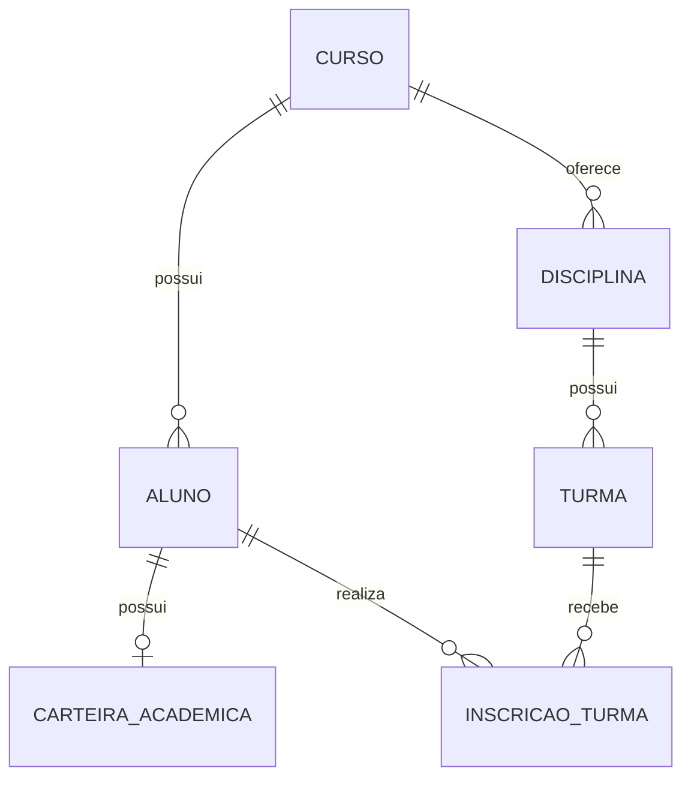

# Cartão de Identidade Acadêmica

Projeto Django para cadastro e consulta de identidades acadêmicas dos alunos da FEPI.

Repositório: <https://github.com/Biancafrs/cartao-identidade-aluno>

## Entrega da semana 1

A entrega inclui:

- quatro models de domínio: `Aluno`, `Curso`, `Disciplina` e `Turma`;
- relações 1:N protegidas contra exclusão acidental;
- migração dos cursos textuais existentes para registros de `Curso`;
- dashboard com indicadores calculados a partir do banco;
- CRUD de alunos, busca por nome ou CPF e filtro por curso;
- dados demonstrativos reproduzíveis e testes automatizados.

## Entrega da semana 2

O CRUD de alunos foi revisado e validado, edição e exclusão agora mostram confirmação após salvar no banco; formulários inválidos orientam a correção dos campos. As telas e o dashboard da semana 1 foram preservados.

Veja o [checklist e os prints da semana 2](docs/entregas/semana-2/README.md). A tag prevista para esta entrega é `semana-2`.

## Entrega da semana 3

A carteira acadêmica de cada aluno usa `OneToOneField`. Alunos podem se inscrever em várias turmas, e cada turma pode receber vários alunos; o vínculo usa `ManyToManyField` com `through=InscricaoTurma` e guarda data e situação da inscrição. Cursos agora têm listagem, cadastro, edição e exclusão fora do Admin.

Veja o [checklist e os prints da semana 3](docs/entregas/semana-3/README.md). A tag prevista é `semana-3`.

## Tecnologias

- Python 3.12 ou mais recente compatível com Django 6.1;
- Django 6.1;
- SQLite;
- HTML, CSS e JavaScript.

O desenvolvimento foi validado localmente com Python 3.14.8 e Django 6.1.

## Instalação

Clone o repositório:

```bash
git clone https://github.com/Biancafrs/cartao-identidade-aluno.git
cd cartao-identidade-aluno
```

No Windows:

```powershell
python -m venv venv
.\venv\Scripts\Activate.ps1
python -m pip install -r requirements.txt
python manage.py migrate
```

No Linux:

```bash
python3 -m venv venv
source venv/bin/activate
python -m pip install -r requirements.txt
python manage.py migrate
```

Para acessar a área administrativa, crie um usuário local. Nenhuma credencial é mantida no código:

```bash
python manage.py createsuperuser
```

Inicie o servidor:

```bash
python manage.py runserver
```

Acesse <http://127.0.0.1:8000/>.

## Dados de demonstração

O comando abaixo cria ou atualiza dados fictícios sem apagar registros existentes:

```bash
python manage.py popular_demo
```

Em um banco vazio, o resultado é:

- 4 alunos, sendo 3 ativos e 1 inativo;
- 2 cursos, com 2 alunos em cada;
- 2 disciplinas;
- 2 turmas.

O comando usa identificadores estáveis e pode ser executado novamente sem duplicar seus registros.

## Rotas

| Rota | Função |
| --- | --- |
| `/` | Dashboard com indicadores e alunos por curso |
| `/aluno/` | Listagem, busca e filtro de alunos |
| `/aluno/novo/` | Cadastro de aluno |
| `/aluno/<id>/` | Detalhes do aluno, carteira acadêmica e inscrições em turmas |
| `/aluno/<id>/editar/` | Edição do aluno |
| `/aluno/<id>/excluir/` | Confirmação de exclusão |
| `/aluno/<id>/carteira/` | Redireciona para a carteira nos detalhes do aluno |
| `/aluno/<id>/carteira/editar/` | Cadastro e edição da carteira; retorna aos detalhes |
| `/aluno/<id>/inscricoes/nova/` | Inscrição do aluno em uma turma |
| `/cursos/` | Listagem de cursos |
| `/cursos/novo/` | Cadastro de curso |
| `/cursos/<id>/editar/` | Edição de curso |
| `/cursos/<id>/excluir/` | Confirmação de exclusão de curso |
| `/admin/` | Administração dos seis models |

## Modelo de dados



- `Aluno.curso` usa `ForeignKey` com `related_name="alunos"`.
- `Disciplina.curso` usa `ForeignKey` com `related_name="disciplinas"`.
- `Turma.disciplina` usa `ForeignKey` com `related_name="turmas"`.
- `CarteiraAcademica.aluno` usa `OneToOneField`; cada carteira pertence a um único aluno.
- `Aluno.turmas` usa `ManyToManyField` com `through="InscricaoTurma"`.
- `InscricaoTurma.aluno` e `InscricaoTurma.turma` são `ForeignKey`; o par aluno/turma é único e a associação guarda data e situação.
- Os vínculos de curso, disciplina e turma usam `PROTECT` para preservar registros dependentes; carteira e inscrição são removidas quando o aluno é excluído.
- Carga horária e ano devem ser positivos; semestre aceita apenas 1 ou 2.

## Evidências

### Dashboard em desktop


O checklist detalhado está em [docs/entregas/semana-1/README.md](docs/entregas/semana-1/README.md).

## Autoria

- Bianca Ferreira

## Uso de IA

Ferramentas de IA foram usadas como apoio ao desenvolvimento do Front-End, implementação, testes e documentação.
